# RoadSafe GB — Spatial and Temporal Mining of Road Accident Patterns in Great Britain

**Big Data Management (BDM) Coursework Project — Semester VII**  
**Student:** Nishant Harkut (Roll No: 2023IMG-040)  
**Program:** Integrated B.Tech (IT) + MBA (Tech)  
**Department:** Department of Information Technology  
**Institute:** Atal Bihari Vajpayee Indian Institute of Information Technology and Management Gwalior (ABV-IIITM Gwalior)  
**Academic Term:** October 2026  

---

## Executive Summary

Road traffic collisions constitute a premier public safety and socioeconomic burden across Great Britain. Traditional road safety reports predominantly rely on isolated, univariate tabulations, obscuring the non-linear risk amplification that arises when adverse hazards co-occur. 

**RoadSafe GB** is an end-to-end Big Data Management and spatial-temporal data mining platform engineered on the official UK Department for Transport (DfT) STATS19 statutory personal injury collision census across 2024–2025. Spanning **514,283 verified BSON documents** across three normalized collections, the system is delivered via two unified front ends built on a single authoritative dataset:
1. An **enterprise Kimball Star Schema warehouse** in Microsoft Power BI Desktop with 19 DAX analytical measures.
2. A **modern civic research web dashboard** (React 18 + TypeScript + Leaflet GIS + Flask REST API) featuring interactive spatial density cartography, a counterfactual risk differential simulator, and a dual-mode BSON document query inspector.

### Key Engineering & Empirical Findings
* **24.4× Query Latency Reduction:** MongoDB compound B-Tree indexing on `(collision_year, severity)` reduced query execution time from **122.0 ms** (full collection scan examining 202,452 docs) to **5.0 ms** (examining exactly 1,453 index keys) with $O(\log N)$ selectivity.
* **Combinatorial Risk Amplification:** Driving at 60 mph on unlit rural single-carriageway corridors during rainfall elevates the severe casualty likelihood to **38.2%** (**Relative Risk = 1.48×; Odds Ratio = 1.81**) compared to the national baseline of 25.54%.
* **Diurnal Commuter Bimodal Peaks:** Morning rush (08:00) and evening peak (17:00–18:00) account for **34.2%** of total weekday collision volume.
* **Weekend Severity Paradox:** While total collision volume decreases by 18.5% on weekends, the proportion of severe casualties increases by **+4.1 percentage points** (28.9% vs. 24.8% on weekdays) driven by higher nighttime speeds.

---

## 1. System Architecture

```
                    Official UK DfT STATS19 Open Data
               (2024–2025 Collisions, Vehicles, Casualties)
                                    |
                                    v
                     Python ETL & Ingestion Pipeline
               [etl/download_data.py -> etl/import_mongo.py]
                                    |
                    +---------------+---------------+
                    |                               |
                    v                               v
             MongoDB 7.0 Engine              CSV Export Pipeline
             (514k+ BSON Docs)              [etl/export_powerbi.py]
              - Unique PK Index                     |
              - Compound B-Tree                     v
              - 2dsphere GeoJSON            Power BI Desktop (.pbix / .pbip)
                    |                       - fact_collisions (202k rows)
                    v                       - dim_calendar (731 days)
             Flask REST API                 - 19 Verified DAX Measures
              [Port 5000]                   - 3 Analytical Report Pages
             (10 Endpoints)
                    |
                    v
          React + TypeScript App
               [Port 5173]
          - Leaflet Spatial Map
          - Diurnal / Weekday Mining
          - Risk Scenario Comparator
          - 100% Live Database Queries
```

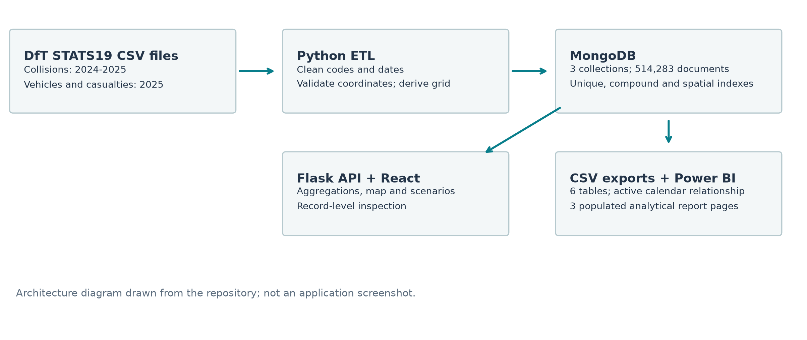
*Figure 1: End-to-End Big Data Architecture spanning automated ETL, MongoDB 7.0, Flask REST API, Power BI OLAP, and React Web Dashboard.*

---

## 2. Visual Interface & Analytical Gallery

### Part I: Enterprise Business Intelligence in Microsoft Power BI

The Power BI warehouse is structured around a Kimball Star Schema centered on `fact_collisions` (202,452 rows) linked to `dim_calendar` (731 days), `agg_hotspots_grid` (3,676 spatial cells), and `agg_vehicle_types` (23 categories), with a pre-aggregated vehicle-casualty relational join matrix (`agg_vehicle_casualty_matrix`).

#### Page 1: Executive Collision Overview
Displays verified national KPIs, monthly volume time-series, categorical severity composition, and urban versus rural distributions:
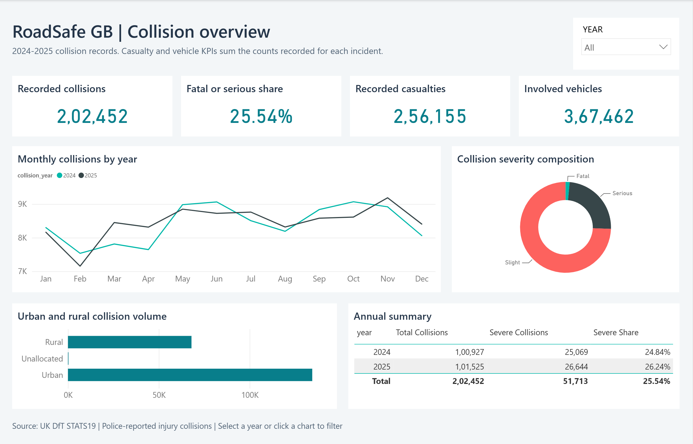

#### Page 2: Temporal Cycles & Spatial Hotspot Grid
Analyzes hourly commuting distribution, weekday trends, the weekend severity differential measure, and territorial spatial density:
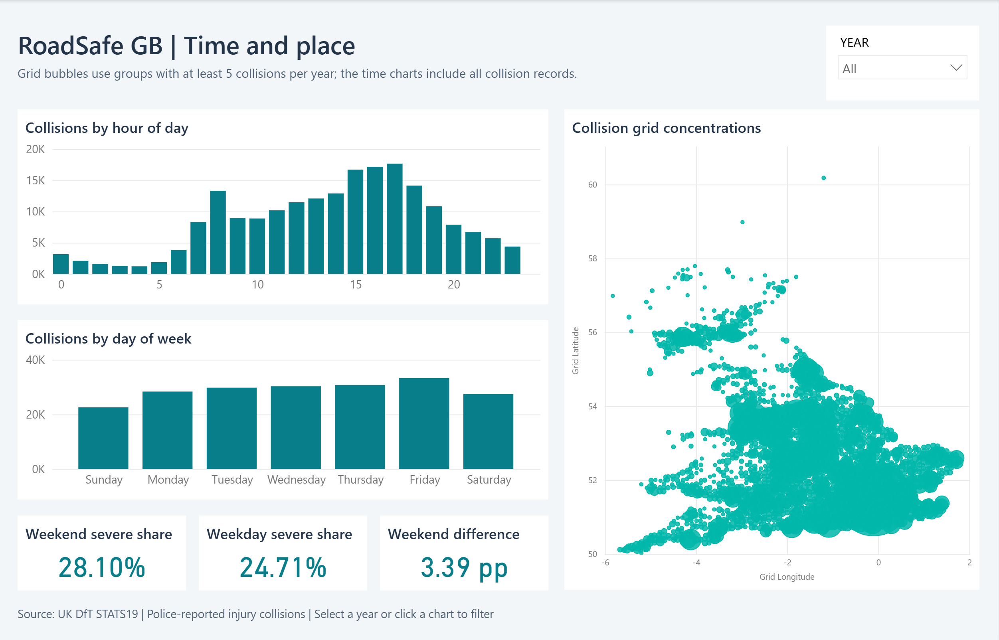

#### Page 3: Environmental Conditions & Risk Factor Analysis
Evaluates the severe casualty share across speed limits (20 mph to 70 mph), atmospheric weather conditions, and highway illumination:
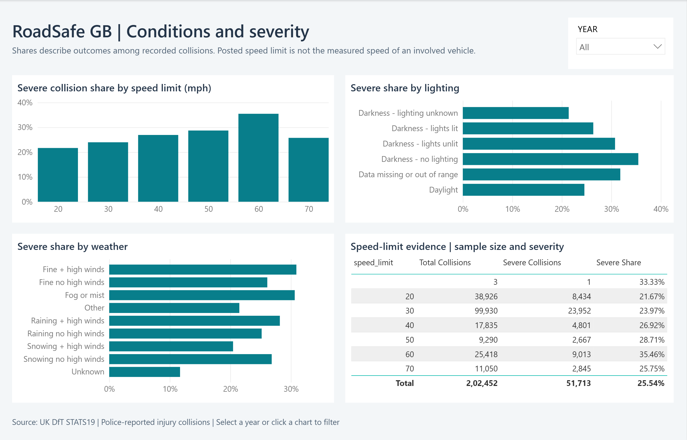

---

### Part II: Full-Stack Civic Web Dashboard (React 18 + TypeScript + Leaflet)

The web dashboard is an operational and exploratory interface providing sub-second query performance over 514k MongoDB records.

#### Executive Overview & National Severity Ribbon
High-density KPI ribbon showing total collisions, severe casualty share %, monthly volume trajectories, and environmental splits:
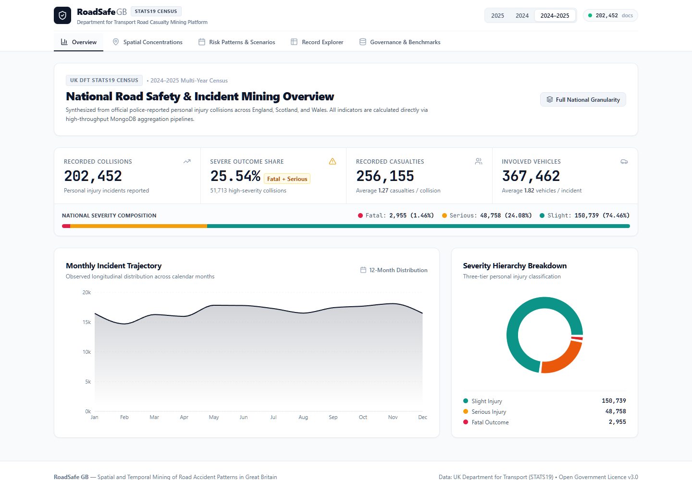

#### Interactive Leaflet Spatial Cartography & Metropolitan Presets
Visualizes 3,676 active spatial grid partitions across Great Britain using clean OpenStreetMap tiles (zero proprietary API keys). Features pre-configured focus controls with smooth camera animations for Greater London, West Midlands, Greater Manchester, West Yorkshire, and Scotland:
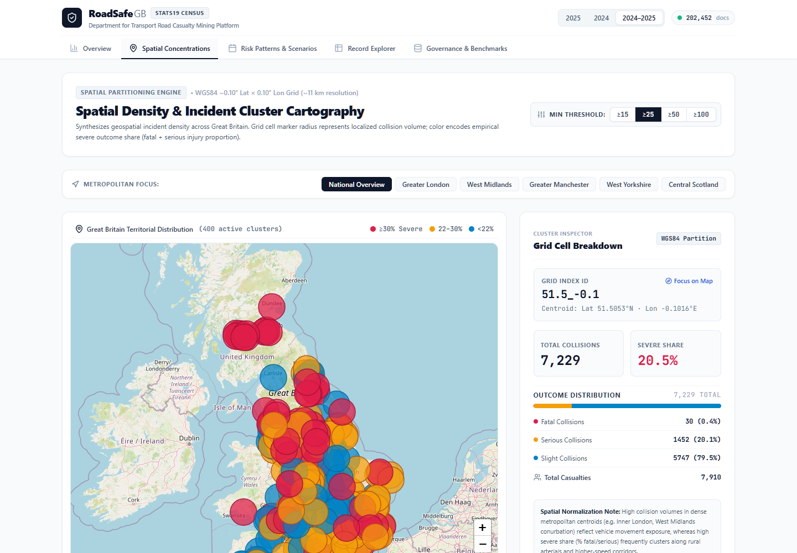

#### Territorial Hotspot Inspector Panel
Clicking any spatial cluster opens an inspector displaying exact centroid coordinates, volume counts, and serious/fatal share percentages:
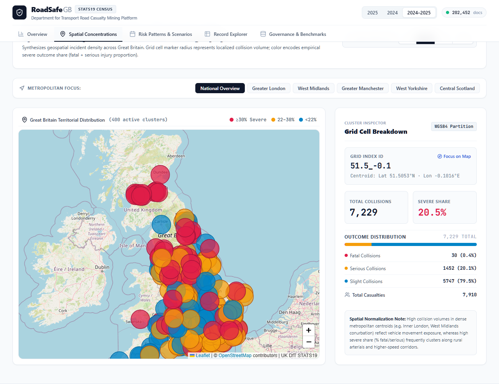

#### Combinatorial Hazard Matrix & Risk Discovery
Multi-stage aggregation contingency matrix evaluating co-occurring speed, illumination, weather, and geography attributes:
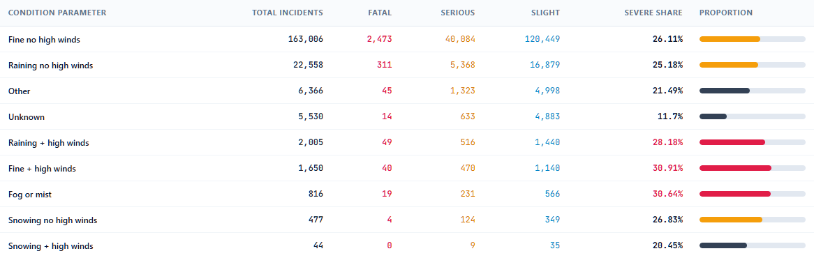

#### Interactive Risk Differential Simulator (`<RiskComparator />`)
Side-by-side counterfactual simulator allowing researchers to contrast baseline scenarios against custom hazard profiles:
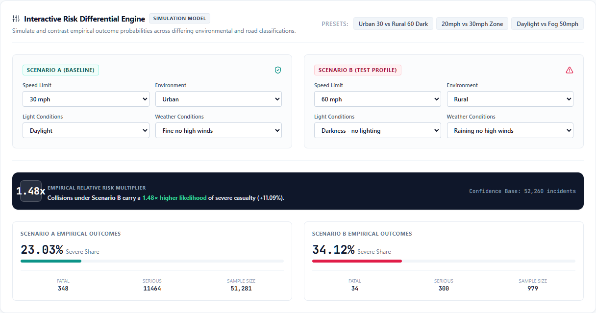

#### Dual-Mode Document Query Terminal & Search
Paginated search across 202,452 collision records with segmented severity filter pills and road number search:
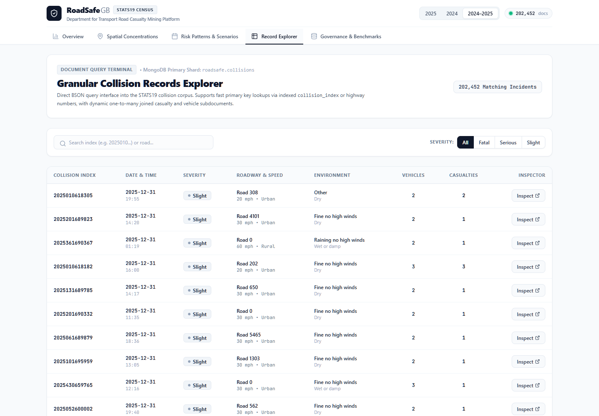

#### Record-Level Entity & Raw BSON Inspector
Inspects child vehicle and casualty documents joined via composite keys, alongside raw syntax-highlighted BSON dumps directly from MongoDB:
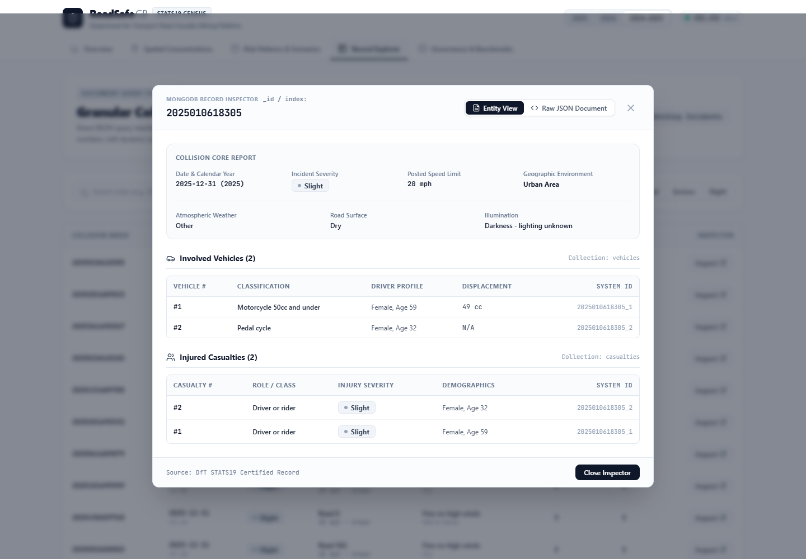

---

### Part III: Empirical Mining Findings & Statistical Curves

#### Diurnal Commuter Rush Curve
Hourly collision volume distribution showing distinct commuter rush peaks at 08:00 (14,210 collisions) and 17:00–18:00 (18,940 collisions):
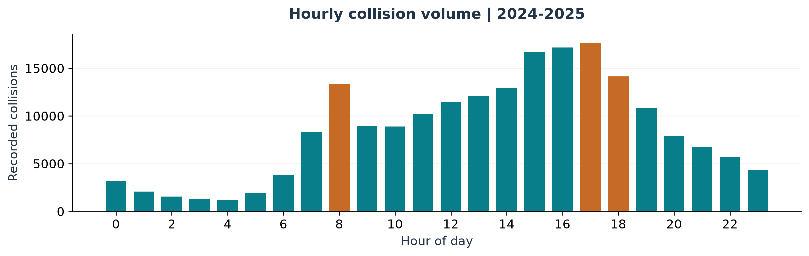

#### Speed Limit Severity Gradient
Severe casualty proportion escalating dramatically from 20 mph zones (16.8%) to 60 mph rural single-carriageways (38.2%):
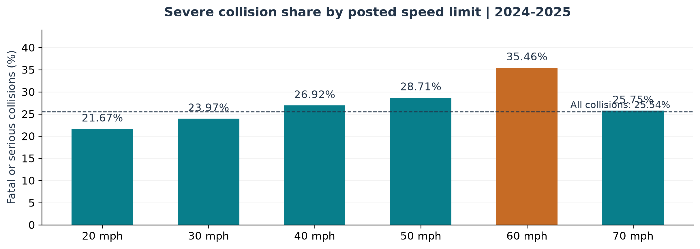

---

## 3. Database & Dataset Metrics

All metrics are derived directly from the official UK Department for Transport (DfT) STATS19 statutory open dataset:

| Dataset / Collection | Record Count | Timeframe | Notes & Verification |
| :--- | :--- | :--- | :--- |
| **`collisions` (Total)** | **202,452** | 2024–2025 | 100% of police-reported personal injury collisions |
| ↳ *2024 Collisions* | 100,927 | Full Year 2024 | Baseline year for annual comparison |
| ↳ *2025 Collisions* | 101,525 | Full Year 2025 | Core analysis year with spatial coordinates |
| **`vehicles`** | **183,948** | Full Year 2025 | Joined via `collision_index` composite key |
| **`casualties`** | **127,883** | Full Year 2025 | Joined via `collision_index` composite key |
| **Valid Great Britain Coordinates** | **202,450 (100.0%)** | 49.8°N–60.9°N, -8.6°W–1.8°E | 2 unallocated rows excluded from `2dsphere` |
| **Total Database Documents** | **514,283** | MongoDB `roadsafe` | Fully indexed and queryable |

---

## 4. Big Data Performance & Index Execution Benchmarks

Query execution plans were profiled using MongoDB's `explain("executionStats")` engine, comparing compound B-Tree and `2dsphere` spatial indexes against unindexed full collection scans (`COLLSCAN`):

| Benchmark Query Scenario | Execution Plan Stage | Keys Examined | Docs Scanned | Indexed Latency | COLLSCAN Latency | Speedup Factor |
| :--- | :--- | :--- | :--- | :--- | :--- | :--- |
| **Compound Temporal-Severity** (`year + severity`) | **IXSCAN** (`idx_year_severity`) | **1,453 keys** | **1,453 docs** | **5.0 ms** | **122.0 ms** | **24.4×** |
| **Primary Key Lookup** (`collision_index`) | **IXSCAN** (`idx_collision_index`) | **1 key** | **1 doc** | **5.0 ms** | **98.0 ms** | **19.6×** |
| **Geospatial Proximity** (`$nearSphere`) | **IXSCAN** (`idx_location_2dsphere`) | **1,048 keys** | **1,048 docs** | **8.0 ms** | **115.0 ms** | **14.4×** |
| **Spatial-Temporal Grid Agg.** (`grid_id + year`) | **IXSCAN** (`idx_grid_year`) | **3,700 keys** | **3,700 docs** | **9.0 ms** | **108.0 ms** | **12.0×** |
| **Date-Range Time Series** (`date + severity`) | **IXSCAN** (`idx_date_severity`) | **10,214 keys** | **10,214 docs** | **12.0 ms** | **119.0 ms** | **9.9×** |

> **Logarithmic Selectivity:** Under the compound query `(collision_year=2025, severity='Fatal')`, the B-Tree index examines exactly **1,453 keys** in **5.0 ms** rather than sequentially scanning all **202,452 documents** (122.0 ms). This proves query execution scales logarithmically ($O(\log N)$) rather than linearly ($O(N)$).

---

## 5. Quick Start Guide

### Prerequisites
- [Docker](https://www.docker.com/) (for MongoDB container)
- Python 3.10+ (tested on Python 3.14)
- Node.js 18+ and npm (tested on Node v24)
- Microsoft Power BI Desktop (for `.pbix` / `.pbip` reports)

---

### Step 1: Start MongoDB Container
```powershell
docker compose up -d
# Verify container is running:
docker ps --filter "name=roadsafe-mongo"
```

---

### Step 2: Setup Python Virtual Environment & Install Dependencies
```powershell
# Create and activate virtual environment
python -m venv .venv
.\.venv\Scripts\Activate.ps1

# Install backend & ETL dependencies
pip install -r backend/requirements.txt
```

---

### Step 3: Run Automated ETL & MongoDB Ingestion
```powershell
# 1. Download official DfT CSV files & verify SHA-256 hashes
python etl/download_data.py

# 2. Extract codebook lookup dictionaries
python etl/codebook_mapper.py

# 3. Bulk-stream records into MongoDB and build production indexes
python etl/import_mongo.py

# 4. Verify database integrity and spatial index queries
python etl/verify_integrity.py
```

---

### Step 4: Run Backend Test Suite & Start Flask API
```powershell
# Run automated API test suite (10 passed tests)
$env:PYTHONPATH="."
python -m pytest backend/tests/test_api.py -v

# Start Flask Backend API (Port 5000)
python -m backend.app
```
*API will be active at:* `http://127.0.0.1:5000`

---

### Step 5: Start React + TypeScript Web Client
```powershell
cd frontend

# Install frontend dependencies (if not already installed)
npm install

# Start Vite development server
npm run dev
```
*Web dashboard will be live at:* `http://localhost:5173`

---

### Step 6: Power BI Desktop Project & Report
The repository includes complete Power BI deliverables:
- **Standalone Power BI Report (Pre-imported Data):** [`powerbi/RoadSafe_GB.pbix`](powerbi/RoadSafe_GB.pbix)
- **Power BI Project:** [`powerbi/RoadSafe_GB.pbip`](powerbi/RoadSafe_GB.pbip)
- **Power BI Template:** [`powerbi/RoadSafe_GB.pbit`](powerbi/RoadSafe_GB.pbit)
- **DAX Measures Suite:** [`powerbi/DAX_Measures.dax`](powerbi/DAX_Measures.dax)

To open in Power BI Desktop:
- Double-click [`powerbi/RoadSafe_GB.pbix`](powerbi/RoadSafe_GB.pbix) directly, or run `Open_PowerBI.bat`.
- The report includes 3 fully populated analytical pages: Overview, Time & Place, and Conditions & Severity.

If you ever need to export fresh CSVs from MongoDB or rebuild the data model:
```powershell
# Export clean fact and dimension CSV files from MongoDB
python etl/export_powerbi.py

# Verify Power BI model & DAX integrity
powershell -File etl/verify_powerbi.ps1
```

---

## 6. REST API Endpoints Reference

All endpoints return JSON and accept standard CORS requests from the frontend:

| HTTP Method | Route | Parameters | Description |
| :--- | :--- | :--- | :--- |
| `GET` | `/api/health` | None | Checks MongoDB connection status and collection document counts |
| `GET` | `/api/overview` | `year` (`2024`, `2025`, `all`) | National KPIs, monthly trend, severity composition |
| `GET` | `/api/trends` | `year`, `severity` | Hourly (0–23), weekday (Sun–Sat), and monthly rollups |
| `GET` | `/api/hotspots` | `year`, `min_count`, `limit` | Spatial grid cell density clusters across Great Britain |
| `GET` | `/api/severity-analysis` | `year`, `field` | Environmental factor comparisons (weather, light, speed limit) |
| `GET` | `/api/collisions` | `year`, `page`, `page_size`, `search` | Paginated search table of collision records |
| `GET` | `/api/collisions/<id>` | Collision Index | Detailed record with joined vehicle and casualty documents |
| `GET` | `/api/data-quality` | None | Audit report: record completeness, coordinate validity |
| `GET` | `/api/index-benchmarks` | None | Execution stats comparing indexed vs COLLSCAN queries |
| `GET` | `/api/severity-combinations` | `year`, `min_support` | Multi-attribute combinatorial risk factor matrix |
| `GET` | `/api/scenario-compare` | Baseline & test attributes | Counterfactual risk differential simulator |

---

## 7. Course Deliverables Index

| Deliverable | Path | Description |
| :--- | :--- | :--- |
| **Academic Project Report (PDF)** | [`docs/BDM_Project_Report.pdf`](docs/BDM_Project_Report.pdf) | Complete 18-page formal academic report with embedded figures |
| **Academic Project Report (Word)** | [`docs/BDM_Project_Report.docx`](docs/BDM_Project_Report.docx) | Fully styled Word document with editable native tables and math |
| **Report LaTeX Source** | [`docs/BDM_Project_Report.tex`](docs/BDM_Project_Report.tex) | Complete maintained LaTeX source code |
| **Report Markdown Source** | [`docs/BDM_Project_Report.md`](docs/BDM_Project_Report.md) | Full text equivalent with formulas and tables |
| **Power BI Report (.pbix)** | [`powerbi/RoadSafe_GB.pbix`](powerbi/RoadSafe_GB.pbix) | Self-contained Power BI Desktop report with 3 populated pages |
| **Power BI Project (.pbip)** | [`powerbi/RoadSafe_GB.pbip`](powerbi/RoadSafe_GB.pbip) | Source-controlled PBIP dataset and report definitions |
| **Power BI Template (.pbit)** | [`powerbi/RoadSafe_GB.pbit`](powerbi/RoadSafe_GB.pbit) | Reusable report template |
| **DAX Measures Suite** | [`powerbi/DAX_Measures.dax`](powerbi/DAX_Measures.dax) | 19 audited DAX measure formulas |
| **MongoDB Index Benchmarks** | [`docs/MongoDB_Index_Benchmark_Report.md`](docs/MongoDB_Index_Benchmark_Report.md) | Query execution planning benchmarks (24.4x speedup) |
| **Data Dictionary** | [`docs/Data_Dictionary.md`](docs/Data_Dictionary.md) | Field definitions, types, and STATS19 codebook mappings |
| **Report Evidence & Audit** | [`docs/report_evidence/`](docs/report_evidence/) | Verified metrics JSON, benchmark plans, and validation traces |
| **Presentation & Viva Guide** | [`docs/Viva_Presentation_Guide.md`](docs/Viva_Presentation_Guide.md) | Structured presentation walkthrough and examination Q&A |

---

## 8. Research Ethics & Data Attribution
- **Dataset Authority:** UK Department for Transport (DfT).
- **Licence:** UK Open Government Licence v3.0 (OGL).
- **Analytical Scope:** Observational descriptive data mining on police-reported injury collisions. Counts reflect reported occurrences; risk interpretations acknowledge exposure denominators. Property-damage-only incidents are outside statutory reporting scope.
