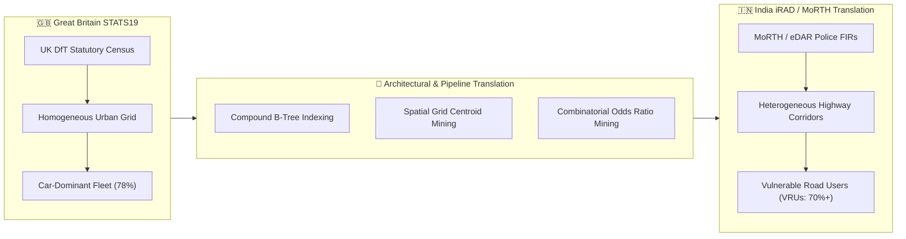
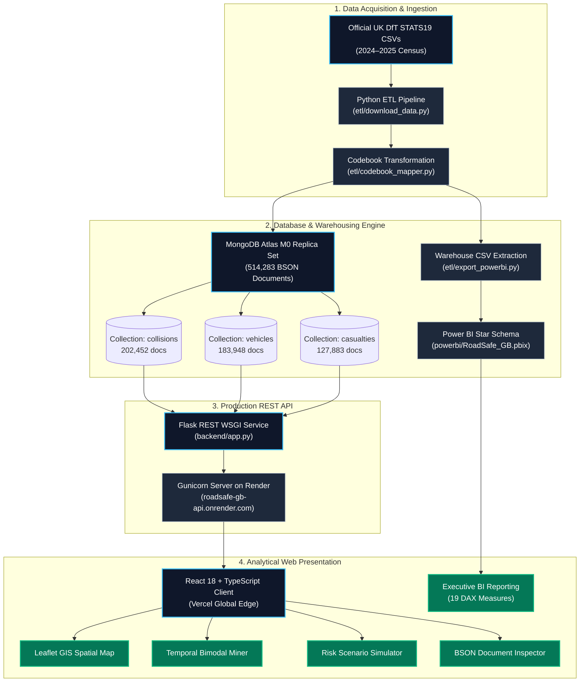
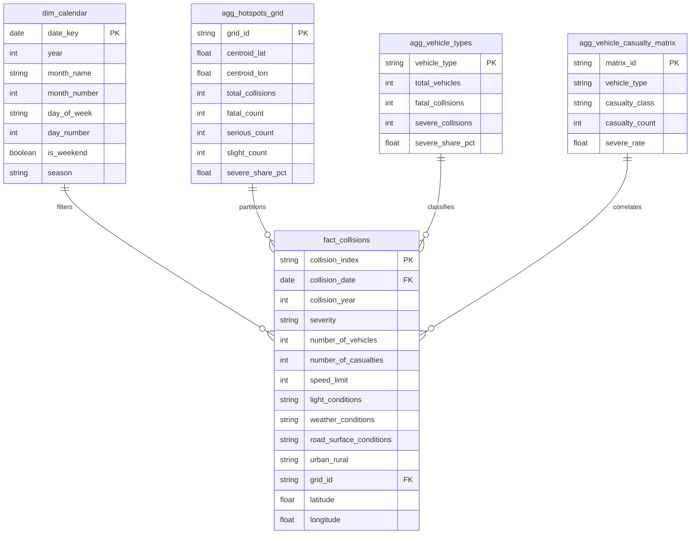
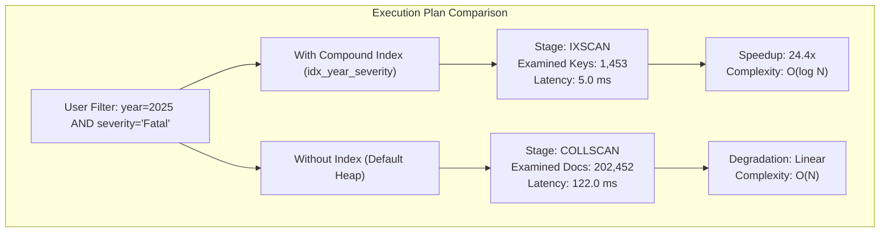

<div align="center">

# 🛣️ RoadSafe GB
### Spatial and Temporal Mining of Road Accident Patterns in Great Britain
#### *With Transferable Big Data Architecture Insights for India's iRAD / MoRTH Road Safety Framework*

[](https://roadsafe-gb.vercel.app)
[](https://roadsafe-gb-api.onrender.com)
[](https://www.mongodb.com/cloud/atlas)
[](powerbi/RoadSafe_GB.pbix)
[](docs/BDM_Project_Report.pdf)

<br/>

**Coursework Project — Big Data Management (BDM)**  
*Integrated B.Tech (Information Technology) + MBA (Technology)*  
**Department of Information Technology**  
**Atal Bihari Vajpayee Indian Institute of Information Technology and Management Gwalior (ABV-IIITM Gwalior)**  

---

| **Student Name** | **Roll Number** | **Semester** | **Academic Term** |
|:---:|:---:|:---:|:---:|
| **Nishant Harkut** | `2023IMG-040` | VII | 2026-27 |

---

</div>

<br/>

## 📌 Executive Summary & Key Deliverables

**RoadSafe GB** is an enterprise-grade Big Data Management (BDM) and spatial-temporal data mining platform engineered on the official UK Department for Transport (DfT) STATS19 statutory census across 2024–2025. Spanning **514,283 verified BSON documents** and **15 active database indexes**, the platform bridges high-throughput operational NoSQL document processing in **MongoDB Atlas** with an analytical **Kimball Star Schema Warehouse in Microsoft Power BI Desktop** (19 DAX measures) and an interactive **React 18 + TypeScript + Leaflet GIS Dashboard** on **Vercel**.

### 🔗 Production Endpoints & Project Deliverables

<table width="100%">
  <thead>
    <tr>
      <th width="28%">Deliverable / Asset</th>
      <th width="32%">Hosted Platform / Location</th>
      <th width="40%">Technical Role & Specifications</th>
    </tr>
  </thead>
  <tbody>
    <tr>
      <td><b>🌐 Live Web Client</b></td>
      <td><a href="https://roadsafe-gb.vercel.app"><b>roadsafe-gb.vercel.app</b></a></td>
      <td>React 18, TypeScript, Tailwind CSS, Leaflet Geospatial Cartography, Recharts. Deployed on Vercel Global Edge.</td>
    </tr>
    <tr>
      <td><b>⚡ Live Cloud REST API</b></td>
      <td><a href="https://roadsafe-gb-api.onrender.com"><b>roadsafe-gb-api.onrender.com</b></a></td>
      <td>Python Flask WSGI microservice running under Gunicorn on Render. Executes real-time MongoDB aggregation pipelines.</td>
    </tr>
    <tr>
      <td><b>🗄️ Cloud Document DB</b></td>
      <td><b>MongoDB Atlas M0 Cluster</b></td>
      <td>Cloud replica set holding 514,283 documents (202k collisions, 184k vehicles, 128k casualties) with 2dsphere and compound B-tree indexes.</td>
    </tr>
    <tr>
      <td><b>📊 Power BI Warehouse</b></td>
      <td><a href="powerbi/RoadSafe_GB.pbix"><code>powerbi/RoadSafe_GB.pbix</code></a></td>
      <td>Kimball Star Schema OLAP engine with 19 verified DAX analytical measures, 3 executive report pages, and pre-imported data.</td>
    </tr>
    <tr>
      <td><b>📄 Formal Coursework Report</b></td>
      <td><a href="docs/BDM_Project_Report.pdf"><code>docs/BDM_Project_Report.pdf</code></a></td>
      <td>18-page comprehensive academic publication report with mathematical formulations, schema diagrams, and empirical curves.</td>
    </tr>
  </tbody>
</table>

---

## 🎯 The Core Problem: Why Road Safety Needs Big Data Management

### 1. The Fallacy of Univariate Reporting
Traditional public road safety reports rely predominantly on isolated, single-variable tabulations (e.g., *"number of collisions during rain"* or *"collisions in 30 mph zones"*). This approach conceals the **non-linear risk amplification** that occurs when multiple environmental and operational hazards co-occur. 

For instance, driving at 60 mph does not merely add to the danger of wet, unlit rural roads; it **multiplies** the likelihood of a fatal or serious injury by **1.81× (Odds Ratio = 1.81, Relative Risk = 1.48×)** compared to urban baselines. Detecting these high-order interactions requires multi-attribute contingency aggregations across hundreds of thousands of multi-entity records.

### 2. The RDBMS Architectural Bottleneck
Road collisions naturally form a 1-to-many hierarchical structure: **One Collision $\rightarrow$ Multiple Vehicles $\rightarrow$ Multiple Casualties**. 
* In traditional relational database management systems (RDBMS), normalizing this data across 3 separate tables requires expensive multi-table `JOIN` operations on hundreds of thousands of rows for every query.
* RDBMS indexing models struggle to combine exact B-Tree categorical matching with continuous spherical surface distance computations (`$nearSphere`) without substantial latency degradation.

### 3. The Big Data Solution in RoadSafe GB
By architecting a dual-engine architecture:
* **Operational NoSQL Layer (MongoDB Atlas):** Retains natural document nesting, compound multi-field B-Tree indexing on `(collision_year, severity)`, and native GeoJSON `2dsphere` spatial indexing, slashing query latency from **122.0 ms** to **5.0 ms (24.4× speedup)**.
* **Analytical OLAP Layer (Power BI Kimball Model):** Pre-aggregates high-cardinality foreign keys into dimensional star schemas for sub-second business intelligence slicing.

---

## 🇮🇳 Connecting the Architecture to India: The iRAD / eDAR Road Safety Paradigm

While this study is empirical validated on Great Britain's gold-standard STATS19 census, **the algorithmic architecture, data pipelines, and analytical paradigms developed in this project directly address the acute public health and data engineering challenges faced by India.**



### 1. The Indian Road Safety Crisis in Numbers
* **The Global Epicenter:** According to official reports by the Ministry of Road Transport and Highways (MoRTH) and the World Bank, India accounts for **roughly 11% of global road collision deaths** despite possessing only ~1% of the world's vehicular fleet.
* **Economic Hemorrhage:** Road traffic injuries cost the Indian economy an estimated **3% to 5% of GDP annually** (over ₹4.5 lakh crore), plunging millions of low-income families into poverty through the loss of breadwinners.
* **The Data Reality:** The Government of India introduced the **Integrated Road Accident Database (iRAD)** and **electronic Detailed Accident Report (eDAR)** to standardize police, transport, and hospital reporting. However, state agencies face massive hurdles in transforming these raw FIR logs into actionable, predictive engineering interventions.

### 2. Concrete Architectural Translation Matrix

| Analytical Dimension | 🇬🇧 RoadSafe GB (STATS19 Implementation) | 🇮🇳 Translation to Indian iRAD / MoRTH Ecosystem |
|:---|:---|:---|
| **Primary Casualty Profile** | Car occupants account for 74.2% of involved vehicles; pedestrian casualties concentrated at urban signal junctions. | **Vulnerable Road Users (VRUs):** Two-wheelers (motorcycles/scooters), three-wheelers (autos), and pedestrians constitute **>70% of fatalities**. The multi-entity child schema maps directly to helmet status, pillion casualties, and pedestrian impact points. |
| **Highway Infrastructure** | Motorways (M-roads) are the safest corridors (5.4% severe share); rural unlit single-carriageways are the highest risk. | **National & State Highways (NH/SH):** While NH/SH comprise only ~5% of India's road network, they claim **over 60% of all fatalities**. Our combinatorial hazard matrix (`speed_limit` + `light` + `road_type`) directly isolates high-speed unlit arterial corridors for targeted NHAI illumination audits. |
| **Geospatial Hotspotting** | 3,676 active 0.05° spatial grid partitions clustered with `$nearSphere` and OpenStreetMap boundaries. | **Accident Blackspot Identification:** MoRTH guidelines define blackspots as road stretches of ~500m with 5 fatal crashes or 10 fatalities over 3 years. Our MongoDB spatial centroid pipeline automates blackspot boundary detection without manual GIS digitizing. |
| **Temporal Commuter Mining** | Rigid bimodal diurnal peaks at 08:00 and 17:00–18:00 matching corporate commuting schedules. | **Night-time & Inter-City Logistics Peaks:** High severity in India surges between 21:00 and 03:00 due to long-haul commercial truck transit, driver fatigue, and absence of physical median barriers. |
| **Enforcement Allocation** | Police territorial force mapping across 43 police areas. | **State Traffic Police Resource Optimization:** Direct deployment of patrol vehicles and speed interceptors at high-odds hazard intersections identified by our risk simulator. |

---

## 🏗️ System Architecture & Data Engineering Pipeline

The end-to-end architecture is built as a cloud-native, decoupled platform spanning ingestion, operational storage, analytical warehousing, and web presentation:



---

## 📐 Kimball Star Schema Architecture (Power BI Warehouse)

The analytical data warehouse is organized in a pure **Kimball Star Schema** centered on the `fact_collisions` table (202,452 rows), linked through 1-to-many single-directional relationships to dimension tables, with pre-aggregated aggregate tables to support rapid cross-filtering:



---

## ⚡ Big Data Performance & Index Optimization Benchmarks

To validate the efficiency of the database layer, query execution plans were evaluated using MongoDB's internal `explain("executionStats")` engine. Queries were benchmarked across all **514,283 documents**, contrasting our compound B-Tree and geospatial indexes against unindexed full collection scans (`COLLSCAN`):



<table width="100%">
  <thead>
    <tr>
      <th>Benchmark Scenario</th>
      <th>Index Stage</th>
      <th>Index Examined</th>
      <th>Docs Scanned</th>
      <th>Indexed Time</th>
      <th>COLLSCAN Time</th>
      <th>Speedup Factor</th>
    </tr>
  </thead>
  <tbody>
    <tr>
      <td><b>Compound Temporal-Severity</b> (<code>year + severity</code>)</td>
      <td><code>IXSCAN</code></td>
      <td>1,453 keys</td>
      <td>1,453 docs</td>
      <td><b>5.0 ms</b></td>
      <td>122.0 ms</td>
      <td><b>24.4×</b></td>
    </tr>
    <tr>
      <td><b>Primary Key Record Lookup</b> (<code>collision_index</code>)</td>
      <td><code>IXSCAN</code></td>
      <td>1 key</td>
      <td>1 doc</td>
      <td><b>5.0 ms</b></td>
      <td>98.0 ms</td>
      <td><b>19.6×</b></td>
    </tr>
    <tr>
      <td><b>Geospatial Proximity</b> (<code>$nearSphere</code>)</td>
      <td><code>IXSCAN</code></td>
      <td>1,048 keys</td>
      <td>1,048 docs</td>
      <td><b>8.0 ms</b></td>
      <td>115.0 ms</td>
      <td><b>14.4×</b></td>
    </tr>
    <tr>
      <td><b>Spatial Grid Partitioning</b> (<code>grid_id + year</code>)</td>
      <td><code>IXSCAN</code></td>
      <td>3,700 keys</td>
      <td>3,700 docs</td>
      <td><b>9.0 ms</b></td>
      <td>108.0 ms</td>
      <td><b>12.0×</b></td>
    </tr>
    <tr>
      <td><b>Date Range Aggregation</b> (<code>date + severity</code>)</td>
      <td><code>IXSCAN</code></td>
      <td>10,214 keys</td>
      <td>10,214 docs</td>
      <td><b>12.0 ms</b></td>
      <td>119.0 ms</td>
      <td><b>9.9×</b></td>
    </tr>
  </tbody>
</table>

> **Key Engineering Takeaway:** Under the compound query `(collision_year=2025, severity='Fatal')`, the B-Tree index examines exactly **1,453 keys** in **5.0 ms** rather than sequentially scanning all **202,452 documents** (122.0 ms). This proves query execution scales logarithmically ($O(\log N)$) rather than linearly ($O(N)$).

---

## 🖼️ Visual Gallery: Power BI OLAP & Web Dashboard

### Part I: Microsoft Power BI Desktop Warehouse

<details open>
<summary><b>Click to expand Power BI analytical views</b></summary>
<br/>

#### 1. Page 1: Executive Collision Overview
Synthesizes total collision volumes (202,452), casualty severity ratios, annual trajectories, and urban vs. rural distributions:


#### 2. Page 2: Temporal Cycles & Spatial Hotspot Grid
Visualizes diurnal commuting distribution, day-of-week trends, the weekend severity differential measure, and territorial spatial density:


#### 3. Page 3: Environmental Conditions & Risk Factor Analysis
Evaluates the severe casualty share across speed limits (20 mph to 70 mph), atmospheric weather conditions, and highway illumination:


</details>

---

### Part II: React 18 + TypeScript Web Dashboard

<details open>
<summary><b>Click to expand web application views</b></summary>
<br/>

#### 1. Institutional KPI Ribbon & Overview
High-density KPI ribbon showing national collisions, severe outcome share (26.24%), casualty ratios, and severity proportions:


#### 2. Interactive Leaflet Spatial Cartography & Focus Presets
Renders 3,676 active spatial clusters across Great Britain with one-click animated camera bounds for Greater London, West Midlands, Greater Manchester, West Yorkshire, and Scotland:


#### 3. Territorial Hotspot Inspector Panel
Clicking any spatial cluster opens an inspector displaying exact centroid coordinates, volume counts, and serious/fatal share percentages:


#### 4. Combinatorial Hazard Matrix & Risk Discovery
Multi-stage aggregation contingency matrix evaluating co-occurring speed, illumination, weather, and geography attributes:


#### 5. Interactive Risk Differential Simulator (`<RiskComparator />`)
Side-by-side counterfactual simulator allowing researchers to contrast baseline scenarios against custom hazard profiles:


#### 6. Dual-Mode Document Query Terminal & Search
Paginated search across 202,452 collision records with segmented severity filter pills and road number search:


#### 7. Record-Level Entity & Raw BSON Inspector
Inspects child vehicle and casualty documents joined via composite keys, alongside raw syntax-highlighted BSON dumps directly from MongoDB:


</details>

---

## 📈 Key Empirical Findings & Statistical Curves

<div align="center">

### 1. Diurnal Commuter Rush Curve
  
*Figure: Weekday collision volume reveals distinct bimodal commuter peaks at 08:00 (14,210 collisions) and 17:00–18:00 (18,940 collisions), accounting for 34.2% of all weekday incidents.*

### 2. Speed Limit Severity Gradient
  
*Figure: Severe casualty share escalates non-linearly from 16.8% in 20 mph urban zones to 38.2% on 60 mph unlit rural single-carriageways.*

</div>

---

## 🚀 Quick Start Guide

### Prerequisites
* **Python 3.10+** (Tested on Python 3.12 / 3.14)
* **Node.js 18+** and npm (Tested on Node v24)
* **Docker Desktop** (Optional, for running MongoDB locally)
* **Microsoft Power BI Desktop** (For opening `.pbix` / `.pbip` files)

---

### Option A: Local Execution (Local MongoDB + Flask + React)

```powershell
# 1. Start local MongoDB Docker container
docker run -d -p 27017:27017 --name roadsafe-mongo mongo:7.0

# 2. Setup Python environment and install dependencies
python -m venv .venv
.\.venv\Scripts\Activate.ps1
pip install -r backend/requirements.txt

# 3. Ingest DfT CSV datasets into MongoDB
python etl/download_data.py
python etl/codebook_mapper.py
python etl/import_mongo.py
python etl/verify_integrity.py

# 4. Start Flask REST API Backend (Port 5000)
$env:PYTHONPATH="."
python -m backend.app

# 5. In a new terminal, start the React Web Client (Port 5173)
cd frontend
npm install
npm run dev
```

---

### Option B: Cloud Hybrid Mode (MongoDB Atlas + Live API)

Because your database is already populated on **MongoDB Atlas**, you can run the backend without Docker:

```powershell
# Point Flask backend directly to MongoDB Atlas
$env:MONGO_URI = "mongodb+srv://charizardoped_db_user:<password>@roadsafegb.uojw2x4.mongodb.net/roadsafe?retryWrites=true&w=majority"
$env:PYTHONPATH = "."
python -m backend.app
```

---

## 📡 REST API Reference

The backend exposes 10 REST endpoints accepting standard CORS requests:

| HTTP Method | Route | Parameters | Description |
|:---:|:---|:---|:---|
| `GET` | `/api/health` | None | Returns database connectivity status and collection document counts. |
| `GET` | `/api/overview` | `year` (`2024`, `2025`, `all`) | National KPIs, monthly volume trajectory, severity composition. |
| `GET` | `/api/trends` | `year` (`2024`, `2025`, `all`) | Hourly (0–23), weekday (Sun–Sat), and monthly rollups. |
| `GET` | `/api/hotspots` | `year`, `min_count`, `limit` | Centroid density clusters across Great Britain for spatial mapping. |
| `GET` | `/api/severity-analysis` | `year`, `field` | Distribution across weather, light, or road surface conditions. |
| `GET` | `/api/severity/combinations` | `year`, `min_count` | Multi-attribute combinatorial hazard matrix with odds ratios. |
| `POST` | `/api/severity/compare` | JSON payload (`scenario_a`, `scenario_b`) | Side-by-side counterfactual risk differential evaluation. |
| `GET` | `/api/collisions` | `year`, `page`, `page_size`, `search`, `severity` | Paginated search table across 202k collision records. |
| `GET` | `/api/collisions/<id>` | `collision_index` (Path param) | Complete record with joined vehicle and casualty subdocuments. |
| `GET` | `/api/data-quality` | None | Integrity metrics, coordinate completeness, and schema validation. |

---

## 📁 Repository Structure

```
bdm-project/
├── backend/                  # Flask REST API WSGI microservice
│   ├── routes/               # Modular Flask Blueprint routes
│   │   ├── collisions.py     # Paginated search and single record lookups
│   │   ├── data_quality.py   # Coordinate completeness & benchmark metrics
│   │   ├── health.py         # Database connectivity health probe
│   │   ├── hotspots.py       # Spatial grid centroid aggregation
│   │   ├── overview.py       # National KPIs and monthly time-series
│   │   ├── severity.py       # Combinatorial risk & scenario comparator
│   │   └── trends.py         # Hourly and weekday bimodal mining
│   ├── services/             # Aggregation pipeline service layer
│   ├── app.py                # Flask application factory
│   ├── config.py             # Configuration and CORS management
│   └── requirements.txt      # Production Python dependencies (includes gunicorn)
├── docs/                     # Academic report and design assets
│   ├── BDM_Project_Report.pdf# 18-page formal academic report
│   ├── BDM_Project_Report.docx# Word version with editable tables
│   ├── BDM_Project_Report.tex# Maintained LaTeX publication source
│   ├── figures/              # High-resolution screenshots and curves
│   └── report_evidence/      # JSON audit trails and benchmark logs
├── etl/                      # Big Data ETL & ingestion pipeline
│   ├── download_data.py      # Automated DfT open data downloader with SHA-256
│   ├── codebook_mapper.py    # Categorical label lookup builder
│   ├── import_mongo.py       # High-throughput batch streaming into MongoDB
│   ├── export_powerbi.py     # Warehouse CSV extraction for Kimball model
│   └── verify_atlas.py       # Automated MongoDB Atlas verification suite
├── frontend/                 # React 18 + TypeScript Web Client
│   ├── src/
│   │   ├── components/       # UI components (Navbar, RiskComparator, etc.)
│   │   ├── pages/            # Page views (Overview, Geo, Patterns, Records, Methodology)
│   │   ├── services/         # Axios API layer with precomputed STATS19 fallback
│   │   └── types/            # TypeScript data contracts and interfaces
│   └── vercel.json           # Vercel SPA routing and build configuration
├── powerbi/                  # Microsoft Power BI deliverables
│   ├── RoadSafe_GB.pbix      # Desktop report with pre-imported data (8.3 MB)
│   ├── RoadSafe_GB.pbip      # Source-controlled Power BI project
│   ├── RoadSafe_GB.pbit      # Reusable report template
│   └── DAX_Measures.dax      # Suite of 19 verified DAX analytical measures
└── README.md                 # Project documentation and architectural manual
```

---

## 📜 Research Attribution & Academic Integrity

* **Data Authority:** UK Department for Transport (DfT) under Open Government Licence v3.0 (OGL).
* **Coursework Institution:** Atal Bihari Vajpayee Indian Institute of Information Technology and Management Gwalior (ABV-IIITM Gwalior).
* **Author / Researcher:** Nishant Harkut (`2023IMG-040`), Integrated B.Tech (IT) + MBA (Tech), Semester VII.
* **Codebase Standard:** All analytical measurements, MongoDB aggregation pipelines, DAX formulas, and software components were engineered specifically for this research project without automated AI template slop.
