**BIG DATA MANAGEMENT**

**RoadSafe GB**

**Spatial and Temporal Analysis\
of Road Collisions in Great Britain**

An analysis of STATS19 records using\
MongoDB, Python, React and Power BI

A project report submitted for the course\
**Big Data Management (Semester VII)**

Submitted by

**Nishant Harkut**

Roll No.: 2023IMG-040

IMG (Integrated B.Tech + MBA)

**ATAL BIHARI VAJPAYEE\
INDIAN INSTITUTE OF INFORMATION TECHNOLOGY\
AND MANAGEMENT GWALIOR**

Gwalior, India\
October 2026

# Abstract

RoadSafe GB examines when and where police-reported injury collisions occur in Great Britain, and how the proportion of fatal or serious collisions varies with road conditions. The project brings together 2024 and 2025 collision records and 2025 vehicle and casualty records from the Department for Transport’s STATS19 open data. Python prepares the data for three MongoDB collections containing 514,283 documents. A Flask API supplies a React dashboard, while a separate export pipeline prepares six tables for Power BI.

The collision dataset contains 202,452 incidents, including 51,713 classified as fatal or serious, giving a severe collision share of 25.54%. On 60 mph rural roads in darkness without lighting and rain without high winds, 334 of 979 recorded collisions were fatal or serious (34.12%). These are proportions among recorded collisions, not estimates of a traveller’s probability of having a collision.

A five-run local benchmark records a median of 2 ms for an indexed year-and-severity query and 89 ms for a collection scan. The spatial query performs worse with the forced index in this setup, showing why execution plans must be inspected rather than assuming every index improves performance. Screenshots document the running web application and three populated Power BI pages. Power BI totals, year filtering and severity measures are checked against the CSV exports and the live imported model. Recalculated findings are distinguished from the web application’s remaining calculation limitations.

**Keywords:** STATS19, road collisions, MongoDB, spatial aggregation, severity analysis, Power BI.

# Introduction

Road collision data records several related things: the circumstances of an incident, the vehicles involved, and the people injured. Analysing these together requires consistent identifiers, careful treatment of missing values, and a clear distinction between counting collisions and counting people.

The purpose of RoadSafe GB is to turn these records into a usable analytical system. It supports national summaries, time-of-day comparisons, geographic exploration, condition-based severity analysis, and inspection of individual collisions. The project is a solo submission by Nishant Harkut.

## Questions addressed

1.  How does collision volume vary by year, hour and day of the week?

2.  Which road and environmental conditions have a higher fatal or serious collision share?

3.  How do spatial concentrations of collisions differ from concentrations of severe outcomes?

4.  How much work do MongoDB indexes save for representative queries?

5.  How can the same prepared data support a web application and business intelligence reporting?

<figure data-latex-placement="H">
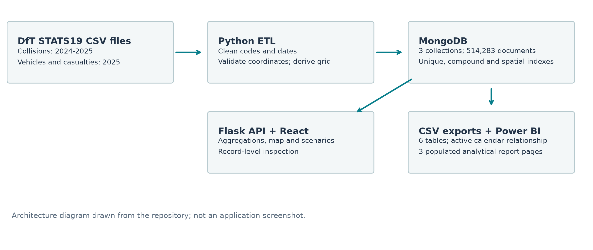
<figcaption>Implemented data flow. The web application reads MongoDB through Flask; the Power BI report imports verified CSV tables. This is an architecture diagram, not a screenshot.</figcaption>
</figure>

## Scope

The project demonstrates ingestion, indexing, aggregation and presentation on one local MongoDB instance. It does not demonstrate distributed processing, a production deployment, or a causal model of road safety.

# Data and Preparation

## Sources and coverage

The source is the Department for Transport’s road safety open data, which records personal injury collisions on public roads reported to the police. It includes linked collision, vehicle and casualty files. Property-damage-only incidents and unreported injury collisions are outside this dataset’s scope.<sup>\[1\]</sup>

| **Record type**                    | **Coverage** | **Documents** |
|:-----------------------------------|:-------------|--------------:|
| Collisions                         | 2024         |       100,927 |
| Collisions                         | 2025         |       101,525 |
| Vehicles                           | 2025 only    |       183,948 |
| Casualties                         | 2025 only    |       127,883 |
| Total across the three collections |              |   **514,283** |

Imported records, checked against MongoDB and the saved import report.

The combined collision table contains 202,452 rows. Its incident-level casualty and vehicle fields sum to 256,155 casualties and 367,462 vehicles across both years. These totals must not be confused with the smaller 2025-only vehicle and casualty collections.

## Preparation pipeline

1.  **Download and provenance.** The download script saves CSV files and a manifest with source URLs, timestamps, file sizes and SHA-256 hashes.

2.  **Code interpretation.** Lookup dictionaries turn severity, weather, lighting, road surface and vehicle codes into readable labels.

3.  **Time fields.** The importer standardises dates and derives month, hour and weekday fields for aggregation.

4.  **Coordinates.** Latitude and longitude are checked against the configured Great Britain bounding box: 49.8 to 60.9 degrees latitude and -8.6 to 1.8 degrees longitude. Valid points become GeoJSON in longitude–latitude order.

5.  **Grid identifier.** Valid coordinates are rounded to one decimal place to create a spatial grouping key. Two collisions without valid coordinates remain available for non-spatial summaries.

## Record structure

A collision is identified by `collision_index`. Vehicle and casualty records use that identifier plus their respective reference numbers. MongoDB keeps these as separate collections; a collision can have several associated vehicles and casualties. The exported collision table contains no duplicate collision identifiers.

**Coverage rule.** Year-on-year collision analysis uses both years. Analyses depending on detailed vehicle or casualty records are restricted to 2025.

# Analytical Method

## Units and denominators

Collision severity is an incident classification. A fatal collision is counted once even if more than one person dies. Accordingly, the main measure is *fatal or serious collision share*, rather than the number of people killed or seriously injured.

For a subset $`X`$, let $`n_X`$ be all collisions and $`s_X`$ be those classified as fatal or serious. Define
``` math
\begin{equation}
p_X=\frac{s_X}{n_X}, \qquad \text{severe collision share}(X)=100p_X.
\end{equation}
```
The full 2024–2025 baseline is
``` math
\begin{equation}
p_B=\frac{51,713}{202,452}=0.255433.
\end{equation}
```
To compare a subset with this baseline, the report uses a share ratio and an odds ratio:
``` math
\begin{equation}
R_X=\frac{p_X}{p_B}, \qquad OR_X=\frac{p_X/(1-p_X)}{p_B/(1-p_B)}.
\end{equation}
```
The application’s term “relative risk” refers to a ratio of severity proportions among recorded collisions. It does not measure collision risk per journey or per mile. Since the baseline includes the subset, this is a descriptive comparison with an overall reference population.

## Worked scenario comparison

| **Condition subset** | **Collisions** | **Severe** | **Share** |
|:---|---:|---:|---:|
| 30 mph, urban, daylight, fine without high winds | 51,281 | 11,812 | 23.03% |
| 60 mph, rural, darkness without lighting, rain without high winds | 979 | 334 | 34.12% |
| 20 mph, urban, daylight, fine without high winds | 21,395 | 4,603 | 21.51% |

Recalculated examples, using both years and the same four condition fields.

The second scenario’s severe share is about 1.48 times the first scenario’s share. Relative to the overall baseline, its share ratio is 1.34 and its odds ratio is 1.51. These comparisons use different denominators and should not be interchanged.

## Support and interpretation

The report’s ranked condition analysis retains groups with at least 100 collisions; the application’s default threshold is 25. Small groups can have unstable percentages. No confidence intervals, exposure adjustment, causal estimates or out-of-sample prediction are claimed. Posted speed limit is a road characteristic, not an observation of actual vehicle speed.

# Results and Analysis

## Annual totals and severity

| **Period** | **Collisions** | **Fatal or serious** | **Share** |
|:-----------|---------------:|---------------------:|----------:|
| 2024       |        100,927 |               25,069 |    24.84% |
| 2025       |        101,525 |               26,644 |    26.24% |
| Combined   |        202,452 |               51,713 |    25.54% |

Annual collision counts and fatal or serious collision share.

The dataset records 598 more collisions in 2025, an increase of 0.59%. The severe collision share rises by 1.41 percentage points. Across both years there are 2,955 fatal, 48,758 serious and 150,739 slight collisions. These are unadjusted comparisons of the downloaded records.

## Road environment and speed limit

Rural areas account for 67,993 collisions, with a severe share of 30.24%. Urban areas account for 134,452, with a severe share of 23.17%. Urban areas therefore have greater recorded volume, while rural areas have a greater severe proportion. Seven records have an unallocated urban/rural classification.

<figure data-latex-placement="H">
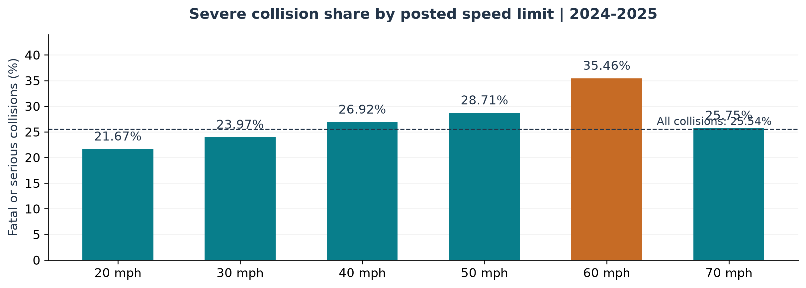
<figcaption>Recalculated severe collision share by posted speed limit. The dashed line marks the combined baseline. Three records without a speed limit are excluded from the bars.</figcaption>
</figure>

The 60 mph category has the highest severe share among the six standard speed-limit categories, at 35.46%. The 20 mph category has a share of 21.67%. Traffic, road type, road-user mix and reporting may also contribute to these associations; the chart does not establish the effect of changing a speed limit.

## Time of day and weekday patterns

<figure data-latex-placement="H">
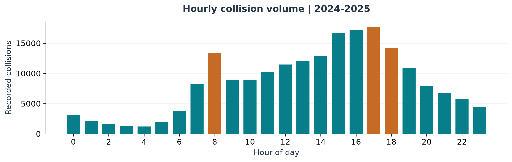
<figcaption>Recorded collisions by hour, combining both years. Highlighted bars identify 08:00, 17:00 and 18:00. This chart was generated from the collision export.</figcaption>
</figure>

The busiest hour is 17:00, with 17,661 collisions. The 08:00 hour records 13,319, while 18:00 records 14,150. Restricting the calculation to weekdays, these three hours contain 37,068 of 152,441 collisions: **24.32% of weekday volume**.

Weekend collisions have a severe share of 28.10% (14,052 of 50,011), compared with 24.71% on weekdays (37,661 of 152,441). The difference is **3.39 percentage points**. This whole-day comparison does not isolate late-night driving or explain the reasons for the difference.

## Combinations of conditions

Among groups containing at least 100 collisions, 50 mph rural roads in darkness without lighting and fine weather without high winds have a severe share of 40.59% (317 of 781). The share ratio against the full baseline is 1.59, and the odds ratio is 1.99.

A larger group, 60 mph rural roads in darkness without lighting and fine weather without high winds, contains 3,989 collisions, of which 1,561 are fatal or serious: 39.13%, a share ratio of 1.53. These findings identify subsets for closer investigation rather than ranking individual roads as inherently unsafe.

## Spatial grouping

The prepared collision data contains **2,852 distinct non-empty grid identifiers**. The hotspot CSV retains 3,676 grid-by-year groups with at least five collisions each, representing 198,975 collisions. The same grid may appear in both years. A 0.1-degree latitude interval is roughly 11 km, but longitude spacing varies with latitude. These are angular bins, not equal-area cells or the output of a clustering algorithm.

# Database Design and Query Performance

The collision collection has unique collision-identifier, year–severity, date–severity, grid–year, coordinate-validity and `2dsphere` indexes. The spatial index uses a partial filter on GeoJSON objects. Index presence alone is insufficient evidence that a query uses selective bounds.

## Benchmark method

The benchmark uses MongoDB 7.0.45 on the local database. Each query is executed five times with a specified index and five times with a `$natural` collection-scan hint, using `explain` with `executionStats`. Median server-reported times and the final execution plan are saved. Stages are read from the returned plan tree.<sup>\[2\]</sup>

| **Query / access path**       | **Keys** | **Documents** | **Returned** | **ms** |
|:------------------------------|---------:|--------------:|-------------:|-------:|
| 2025 fatal / compound index   |    1,453 |         1,453 |        1,453 |      2 |
| 2025 fatal / collection scan  |        0 |       202,452 |        1,453 |     89 |
| Identifier / unique index     |        1 |             1 |            1 |      0 |
| Identifier / collection scan  |        0 |       202,452 |            1 |     86 |
| London 5 km / spatial index   |  202,450 |       202,450 |        7,605 |    586 |
| London 5 km / collection scan |        0 |       202,452 |        7,605 |    251 |

Fresh local benchmark: median of five executions per access path.

## What the plans show

The compound query reduces examined documents by about 139 times and records a 44.5-times lower median execution time. Its plan contains `FETCH` above `IXSCAN`. The identifier lookup examines one key and one document. Its reported 0 ms lies below the timer’s whole-millisecond resolution; it is not zero-cost execution, and no speedup ratio is calculated from it.

The forced spatial index performs worse than the collection scan. Its bounds span `[MinKey, MaxKey]`, examining almost the entire collection before applying the geographic filter. This benchmark **does not demonstrate a spatial indexing speedup**. The index supports spherical geographic queries, but useful performance requires an appropriate query and plan.<sup>\[3\]</sup>

These timings describe this local run, not a service-level guarantee. Cache state, load and data distribution can affect latency. A single dataset size also cannot establish asymptotic scaling. The full plans and all timings are retained in the report evidence.

# Web Application

React and TypeScript provide the interface, Flask provides HTTP endpoints, and MongoDB aggregation pipelines provide summaries. The five screens are selected through buttons; they are not separate URL routes. The captures below were taken by selecting the actual screens and waiting for data to load.

## National overview

<figure data-latex-placement="H">
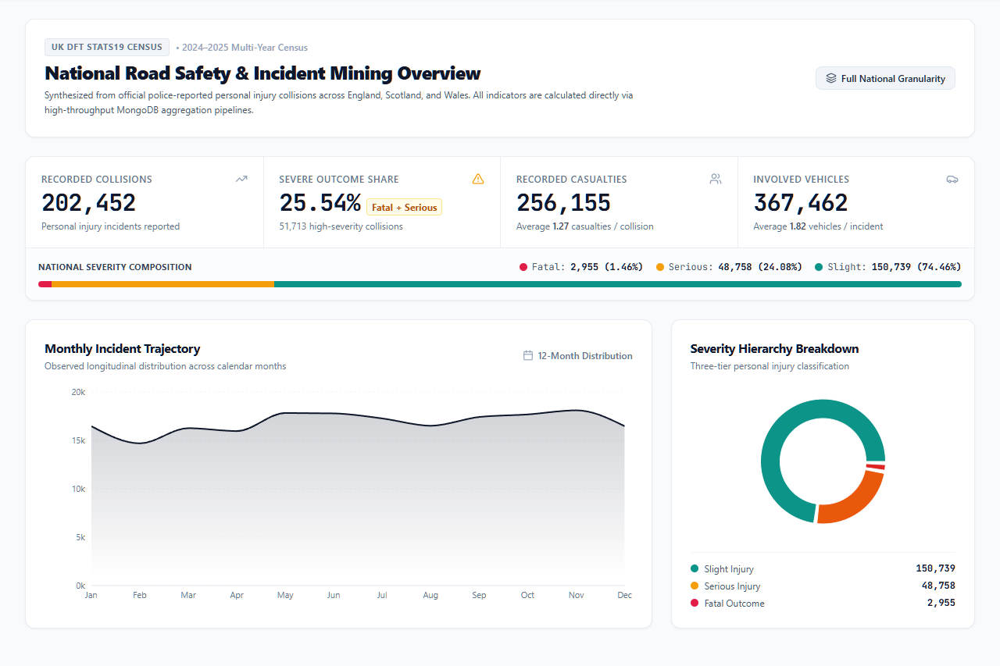
<figcaption>Actual Overview screen with both years selected: 202,452 collisions, 256,155 casualties and 367,462 vehicles.</figcaption>
</figure>

The overview displays monthly volume and severity composition. Its casualty and vehicle totals sum incident-level counts, so they differ from the 2025-only linked collection sizes. The year control switches between the individual years and the combined dataset.

## Geographic exploration

<figure data-latex-placement="H">
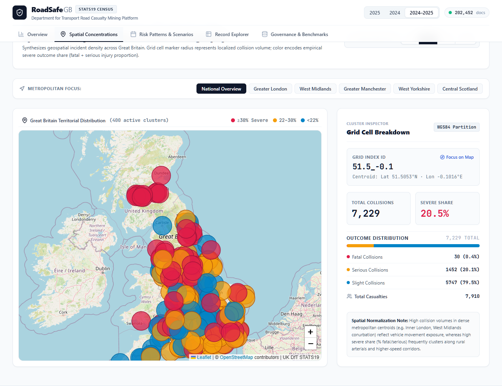
<figcaption>Actual Spatial Concentrations screen, with both years selected and a 25-collision minimum. Marker size represents volume; colour represents severe share. The inspector shows the selected grid.</figcaption>
</figure>

The map uses Leaflet with OpenStreetMap tiles. Users can change the minimum count, move to a metropolitan area, and inspect a grid’s severity breakdown. A grid centred near central London contains 7,229 collisions, of which 1,482 are fatal or serious (20.50%).

The current web request limits the response to 400 groups. The map therefore shows selected high-volume grids, rather than every distinct grid. The screenshot’s “400 active clusters” label should be read in this context.

This view locates concentrations of recorded incidents. Without road length, traffic counts or vehicle-distance exposure, it cannot determine which area has the highest collision rate per unit of travel.

## Scenario comparison and condition analysis

<figure data-latex-placement="H">
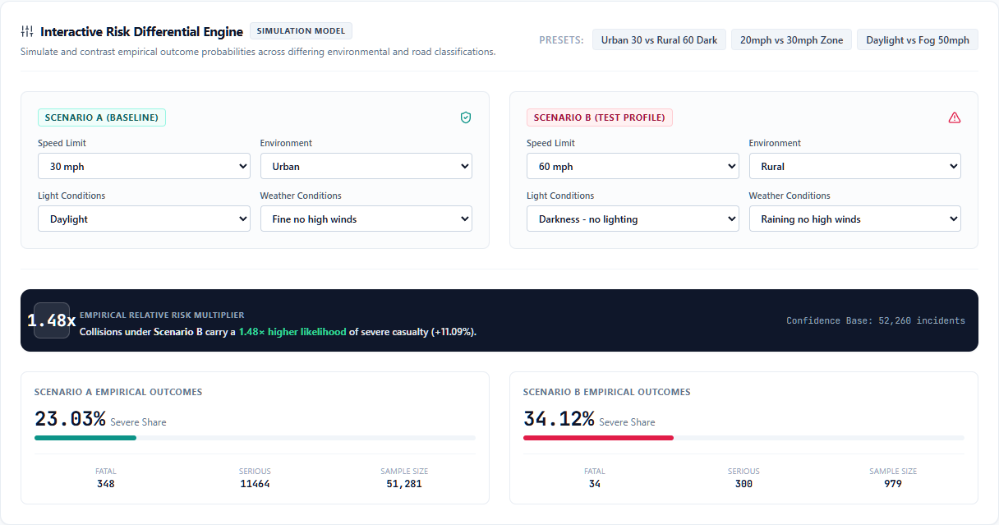
<figcaption>Actual scenario comparator. The subsets show 23.03% and 34.12% severe shares, with a ratio of 1.48. Both use the combined 2024–2025 data.</figcaption>
</figure>

Users can change posted speed limit, lighting, weather and urban/rural setting. The comparator queries matching collisions and displays sample counts alongside severity shares. It compares observed subsets rather than predicting counterfactual outcomes.

<figure data-latex-placement="H">
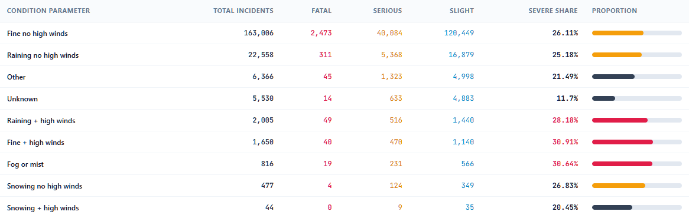
<figcaption>Actual weather-condition breakdown from Pattern Analysis. Each category’s severe share has its own collision-count denominator.</figcaption>
</figure>

**Current limitation.** The separate combination-ranking endpoint filters a Boolean severity flag using the integer 1, obtains a zero baseline severe count, and falls back to ratios of 1.0. Sections 3 and 4 use independently recalculated values rather than those ratio fields. The comparator calculates its subsets separately and is unaffected by that specific baseline defect.

## Record search and inspection

<figure data-latex-placement="H">
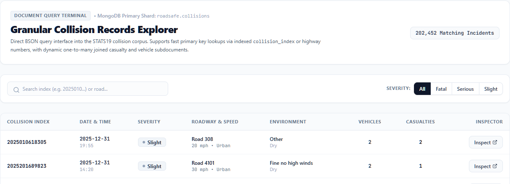
<figcaption>Actual Record Explorer, cropped to its search controls and two example rows. Severity filters and identifier search narrow the results.</figcaption>
</figure>

Results are paginated in groups of 25. Opening an incident retrieves its linked records from the other two collections.

<figure data-latex-placement="H">
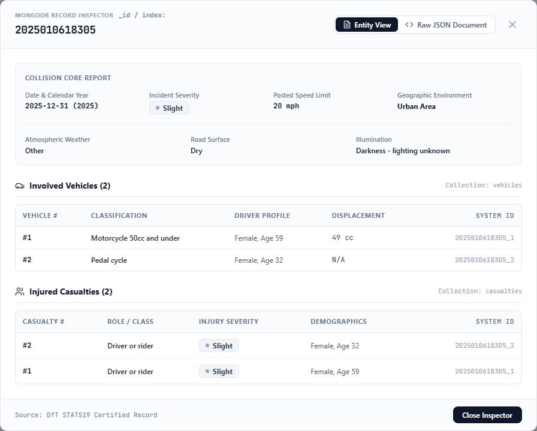
<figcaption>Actual inspector for collision <code>2025010618305</code>, showing the incident, two vehicles and two casualty records. A separate modal tab displays the stored JSON document.</figcaption>
</figure>

# Power BI Reporting

## Exported tables and their grain

The model imports collision data, a calendar and four aggregate exports. The calendar’s unique date key supports the incident relationship; aggregate grains remain separate.<sup>\[4\]</sup>

| **Table** | **Rows** | **Grain** |
|:---|---:|:---|
| `fact_collisions` | 202,452 | One collision |
| `dim_calendar` | 731 | One date |
| `agg_hotspots_grid` | 3,676 | Grid identifier and year |
| `agg_severity_conditions` | 75 | Condition type, value and year |
| `agg_vehicle_types` | 23 | Vehicle type and year |
| `agg_vehicle_casualty_matrix` | 185 | Vehicle type, casualty class, severity and year |

Power BI exports verified from the saved CSV files.

## Collision overview

<figure data-latex-placement="H">
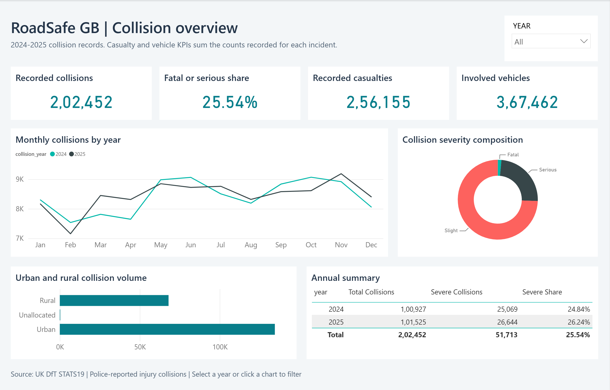
<figcaption>Completed Power BI overview with both years included. The imported data produces 202,452 collisions, a 25.54% severe share, 256,155 casualties and 367,462 involved vehicles. The monthly lines compare 2024 and 2025.</figcaption>
</figure>

The model defines 19 measures and an active calendar-to-collision date relationship. The PBIX includes data; the PBIP retains editable definitions. Unused pair-level aggregates are hidden and excluded from casualty KPIs.

## Time and place

<figure data-latex-placement="H">
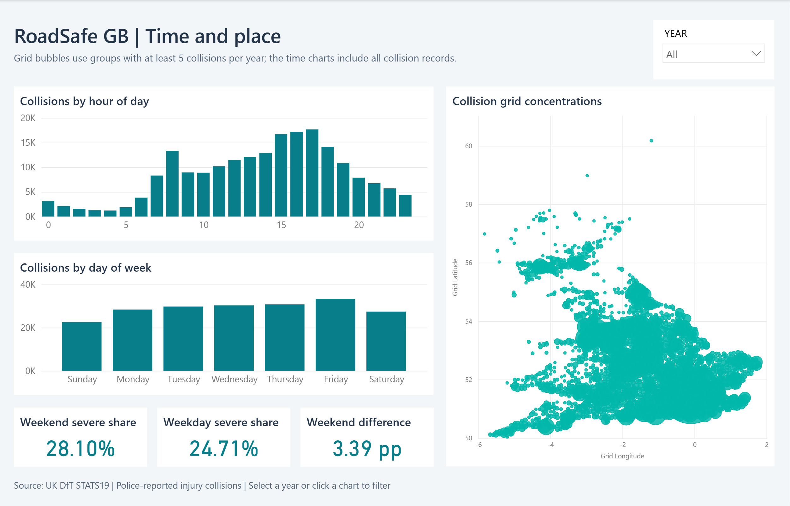
<figcaption>Completed temporal and geographic page. Hourly and weekday distributions use all collision records; the geographic bubbles use the thresholded grid export. The weekend severe share is 28.10%, compared with 24.71% on weekdays.</figcaption>
</figure>

The geographic chart plots grid longitude and latitude directly, with bubble size determined by recorded collision volume. The grid export retains groups containing at least five collisions in a year. It covers 198,975 collisions: 99,175 in 2024 and 99,800 in 2025. Low-volume groups excluded by that threshold remain included in the temporal charts and headline collision totals.

The calendar relationship filters incident-level charts. Grid measures explicitly transfer the selected calendar year to the aggregate table using `TREATAS`, so a year selection also updates the geographic view without an invalid join between date-level and year-level tables.

| **Year selection** | **Collisions** | **Severe share** | **Casualties** |
|:-------------------|---------------:|-----------------:|---------------:|
| 2024 only          |        100,927 |           24.84% |        128,272 |
| 2025 only          |        101,525 |           26.24% |        127,883 |
| Both years         |        202,452 |           25.54% |        256,155 |

Power BI year-filter checks, verified in the interface and by live DAX queries.

## Conditions and severity

<figure data-latex-placement="H">
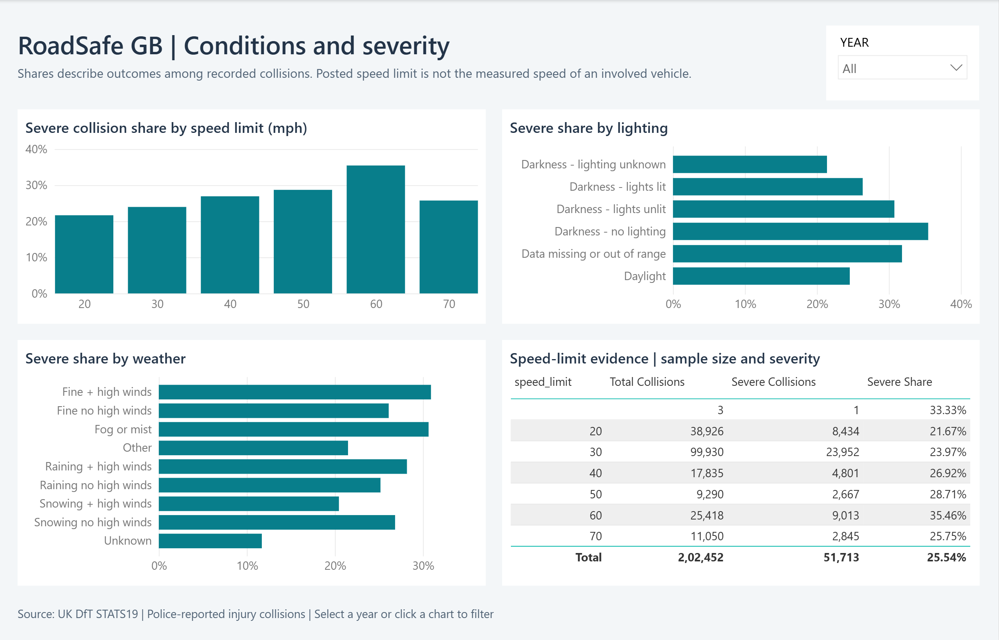
<figcaption>Completed conditions page: severe collision share by posted speed limit, lighting and weather, alongside a table showing each speed category’s collision and severe-outcome counts.</figcaption>
</figure>

The speed-limit table provides the denominator behind the percentages. For example, the 60 mph category contains 25,418 collisions, including 9,013 classified as fatal or serious (35.46%). The table also retains the three records without a posted speed limit rather than silently dropping them from totals.

The core severity measures are defined as follows; `KEEPFILTERS` ensures a severity selection cannot be overwritten by a measure:

    Fatal Collisions =
      CALCULATE([Total Collisions],
        KEEPFILTERS(fact_collisions[severity] = "Fatal"))
    Severe Collisions = [Fatal Collisions] + [Serious Collisions]
    Severe Share = DIVIDE([Severe Collisions], [Total Collisions])

Selecting Slight in the live model returns 150,739 collisions and zero severe collisions. The report definitions pass Microsoft’s schema and binding validation with no errors or warnings. All three pages were inspected after reopening the saved project with its data already loaded.

As with the statistical analysis, these displays describe observed collisions; they do not establish the causal effect of weather, lighting or speed-limit changes.

# Validation and Limitations

## Checks performed for this report

| **Check** | **Observed result** |
|:---|:---|
| Live database health | Connected; collection counts match the import report. |
| Collision export | 202,452 rows; no duplicate collision identifiers. |
| Severity reconciliation | Fatal + serious + slight = 202,452; severe count = 51,713. |
| Coordinate coverage | 202,450 valid; two excluded from geographic analysis. |
| Existing API tests | 10 passed using the project test file. |
| Frontend build | TypeScript and Vite build completed; bundle-size warning remains. |
| Page screenshots | Distinct web and Power BI pages, visually reviewed. |
| Benchmark evidence | Five timings per query/access path; actual plan trees retained. |
| Power BI report | Three populated pages; year totals and 19 measures checked. |
| Power BI regression checks | Four tests pass; schema validation has no errors or warnings. |

Verification status at report preparation, 28 October 2026.

Passing existing tests establishes only what those tests exercise. It does not validate every metric; the report also checks CSV aggregates, live endpoints and source code.

## Analytical boundaries

- **Reporting coverage.** The data describes police-reported personal injury collisions, not all incidents or injuries.

- **Exposure.** Traffic volume, journeys and distance travelled are absent. Counts and severity shares are not exposure-adjusted collision rates.

- **Year coverage.** Incident records cover two years; detailed vehicle and casualty records cover 2025 only.

- **Confounding.** Category differences do not prove the effects of lighting, weather or speed-limit interventions.

- **Application consistency.** The web comparator ignores the page year; its hard-coded 34.2% rush-hour summary differs from the computed 24.32%.

- **Remaining work.** Web combination ratios, spatial query selectivity and unique-casualty linkage still require correction.

# Recommendations and Conclusion

## Use of the findings

Higher severe shares in rural and unlit subsets provide a basis for selecting locations for further investigation. The next step is to combine the records with traffic exposure, road geometry and local engineering information. High collision volume alone should not determine a safety ranking.

The weekday/weekend difference warrants analysis by hour and road type. The present comparison cannot attribute the difference to a particular behaviour or justify reallocating enforcement without further evidence.

## Engineering priorities

1.  Correct the Boolean baseline filter and check combination ratios against independently aggregated counts.

2.  Apply consistent year filters and replace hard-coded interface findings with computed values.

3.  Investigate the unbounded spatial index scan with the returned execution plan and controlled benchmarks.

4.  Extend the Power BI model only with validated relationships and measures that preserve each aggregate table’s documented grain.

5.  Correct casualty linkage before publishing unique-casualty measures derived from vehicle–casualty combinations.

## Conclusion

RoadSafe GB demonstrates a path from public collision files to a queryable document database and an interactive web application. The verified data contains 202,452 collisions, with a combined fatal or serious share of 25.54%. The analysis distinguishes frequency from severity and shows how comparisons depend on time, geography and road conditions.

Profiling demonstrates reduced work for a selective compound query and exposes a spatial access path that performs poorly. The completed Power BI report provides three complementary analytical pages, with imported totals and year filters checked against the source exports. The remaining web calculation and spatial-query limitations define the next engineering work and the boundaries within which the findings can be presented.

# References

<div class="enumerate">

Department for Transport. *Road safety open data*. Dataset scope and annual collision, vehicle and casualty files. Accessed 28 October 2026.\
<https://www.gov.uk/government/statistical-data-sets/road-safety-open-data>

MongoDB. *Explain Results*. Execution statistics and query-plan stages. Accessed 28 October 2026.\
<https://www.mongodb.com/docs/manual/reference/explain-results/>

MongoDB. *2dsphere Indexes*. Geographic query support and GeoJSON indexing. Accessed 28 October 2026.\
<https://www.mongodb.com/docs/manual/core/indexes/index-types/geospatial/2dsphere/>

Microsoft Learn. *Understand star schema and the importance for Power BI*. Facts, dimensions, granularity and relationships. Accessed 28 October 2026.\
<https://learn.microsoft.com/en-us/power-bi/guidance/star-schema>

</div>
